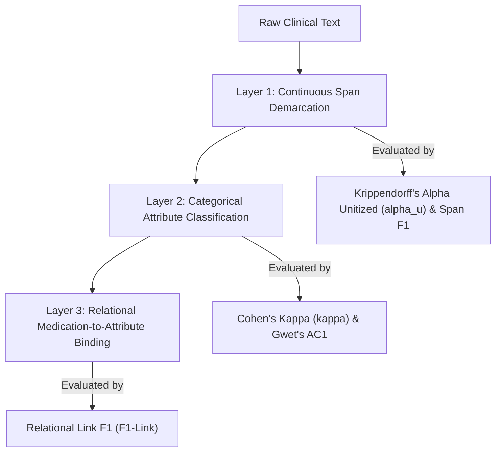
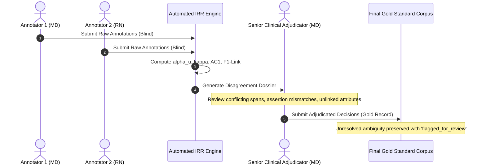

# PULSE — Annotation Agreement Protocol & Inter-Rater Reliability Specification

## 1. Scope & Objective

This document establishes the formal statistical methodology, computational algorithms, and clinical workflows for measuring **Inter-Rater Reliability (IRR)** in the PULSE benchmark.

The protocol ensures that gold-standard annotations produced by clinical annotators achieve quantifiable consistency before being utilized for model evaluation.

### 1.1 Fundamental Measurement Principles
1. **Separation of Metrics**: Agreement across continuous spans, categorical labels, and relational attribute links measure distinct cognitive annotation tasks. **Cohen's kappa, Krippendorff's alpha, and Link-Level F1 are not interchangeable.**
2. **Pre-Adjudication Measurement**: All IRR metrics must be computed strictly on raw, independent dual annotations **prior** to any clinical adjudication, discussion, or consensus reconciliation.
3. **Prevalence Paradox Awareness**: Clinical handover text displays extreme class imbalance (e.g., negative assertions or rare complications occur infrequently). The protocol mandates reporting Chance-Corrected agreement (Gwet's $AC_1$) alongside Cohen's $\kappa$ to prevent misleadingly depressed scores.
4. **Zero-Claim Integrity**: In accordance with research standards, this document specifies the protocol and calculation procedure. **No actual IRR score may be claimed until independent annotators have completed dual annotation of authorized clinical notes.**

---

## 2. The Three Dimensions of Clinical Annotation Agreement

Clinical handover annotation consists of three hierarchical layers:



---

## 3. Span Boundary Agreement: Krippendorff's Unitized Alpha ($\alpha_u$)

### 3.1 Motivation
Standard categorical kappa assumes discrete, pre-segmented units. In free-text clinical handover notes, annotators must independently identify both the start and end boundaries $[start\_char, end\_char)$ of clinical concepts on a continuous textual continuum of length $L$. Boundary disagreements can involve partial overlaps (e.g., *"acute appendicitis"* vs. *"appendicitis"*).

### 3.2 Mathematical Formulation
Krippendorff's unitized alpha ($\alpha_u$) evaluates agreement on continua with variable-length units:

$$\alpha_u = 1 - \frac{D_o}{D_e}$$

Where:
- $D_o$ is the observed disagreement between annotators across the text length $L$.
- $D_e$ is the expected disagreement by chance across all possible unitizations.

For two annotators $A$ and $B$, let the text continuum be indexed $t \in [1, L]$. For any segment $(s, e)$ annotated by $A$ with category $c_A$ and segment $(s', e')$ annotated by $B$ with category $c_B$, the unitized distance function $d(u_A, u_B)$ is defined by the non-overlapping character lengths squared:

$$d(u_A, u_B) = (s - s')^2 + (e - e')^2 + \delta(c_A, c_B)$$

Where $\delta(c_A, c_B) = 0$ if categories match, and $L^2$ if categories differ.

### 3.3 Complementary Token/Character Span $F_1$
Because $\alpha_u$ can be computationally intensive on large corpora, pairwise Span $F_1$ is computed alongside $\alpha_u$:
- **Strict Span Match**: An entity identified by Annotator $A$ matches Annotator $B$ if and only if $start_A = start_B$, $end_A = end_B$, and $category_A = category_B$.
- **Lenient / Partial Span Match**: Matches if $category_A = category_B$ and the character Intersection-over-Union ($\text{IoU}$) exceeds threshold $\tau = 0.5$:

$$\text{IoU}(A, B) = \frac{|(start_A, end_A) \cap (start_B, end_B)|}{|(start_A, end_A) \cup (start_B, end_B)|} \ge 0.5$$

Pairwise Precision, Recall, and $F_1$ are computed taking Annotator $A$ as pseudo-reference against Annotator $B$.

---

## 4. Categorical Agreement: Cohen's $\kappa$, Fleiss' $\kappa$, and Gwet's $AC_1$

### 4.1 Cohen's Kappa Formulation
For pre-identified overlapping entities, categorical agreement evaluates whether annotators assign the same discrete labels (e.g., `macro_category`, `assertion`, `temporality`, `investigation_status`):

$$\kappa = \frac{P_o - P_e}{1 - P_e}$$

Where:
- $P_o = \frac{1}{N} \sum_{i=1}^k n_{ii}$ is the relative observed agreement.
- $P_e = \sum_{j=1}^k p_{A, j} \cdot p_{B, j}$ is the hypothetical probability of chance agreement.

### 4.2 The Prevalence Paradox in Clinical Notes
In clinical documentation, certain categories exhibit extreme class imbalance:
- In `assertion`, $> 85\%$ of clinical entities are `"Positive"`, while `"Negated"` ($\approx 10\%$) and `"Possible"` ($\approx 5\%$) are rare.
- **The Paradox (Feinstein & Cicchetti, 1990)**: When marginal totals are highly asymmetric (e.g., $p_{\text{Positive}} = 0.90$), chance probability $P_e$ becomes very high ($P_e \approx 0.82$). As a result, even if observed agreement $P_o = 0.94$, Cohen's $\kappa$ collapses:

$$\kappa = \frac{0.94 - 0.82}{1 - 0.82} = \frac{0.12}{0.18} = 0.67 \quad (\text{"Substantial" despite 94\% raw agreement})$$

### 4.3 Remedy: Gwet's $AC_1$ Statistic
To prevent penalizing annotators for natural clinical prevalence, PULSE mandates reporting **Gwet's $AC_1$** alongside Cohen's $\kappa$:

$$AC_1 = \frac{P_o - P_{e, \gamma}}{1 - P_{e, \gamma}}$$

Where chance agreement $P_{e, \gamma}$ is adjusted for category trait prevalence:

$$P_{e, \gamma} = \frac{1}{k-1} \sum_{j=1}^k \pi_j (1 - \pi_j), \quad \text{with } \pi_j = \frac{p_{A, j} + p_{B, j}}{2}$$

### 4.4 Categorical IRR Benchmark Targets
For gold-standard qualification, the pre-adjudication thresholds are:
- **Macro-Category Agreement**: Cohen's $\kappa \ge 0.80$, Gwet's $AC_1 \ge 0.85$.
- **Assertion Agreement**: Cohen's $\kappa \ge 0.75$, Gwet's $AC_1 \ge 0.90$, $P_o \ge 0.92$.
- **Temporality Agreement**: Cohen's $\kappa \ge 0.75$, Gwet's $AC_1 \ge 0.85$.
- **Investigation Status Agreement**: Cohen's $\kappa \ge 0.80$, Gwet's $AC_1 \ge 0.90$.

---

## 5. Relational Agreement: Medication-to-Attribute Link Agreement ($F_1$-Link)

### 5.1 Relational Unit Definition
Medication attribute extraction requires binding a medication entity to its modifiers. A relation is defined as a directed relational triple:

$$\mathcal{R} = (E_{\text{med}}, \text{rel\_type}, A_{\text{attr}})$$

Where:
- $E_{\text{med}}$ is the character span of the medication entity (e.g., `(59, 70, "Paracetamol")`).
- $\text{rel\_type} \in \{\text{"has\_dosage"}, \text{"has\_route"}, \text{"has\_frequency"}, \text{"has\_prn\_indication"}\}$.
- $A_{\text{attr}}$ is the verbatim character span of the attribute (e.g., `(71, 77, "650 mg")`).

### 5.2 Link-Level Precision, Recall, and $F_1$
Let $\mathcal{R}_A$ be the set of relational triples produced by Annotator $A$, and $\mathcal{R}_B$ by Annotator $B$:

$$\text{Precision}_{\text{link}} = \frac{|\mathcal{R}_A \cap \mathcal{R}_B|}{|\mathcal{R}_A|}, \quad \text{Recall}_{\text{link}} = \frac{|\mathcal{R}_A \cap \mathcal{R}_B|}{|\mathcal{R}_B|}$$

$$F_1\text{-Link} = 2 \cdot \frac{\text{Precision}_{\text{link}} \cdot \text{Recall}_{\text{link}}}{\text{Precision}_{\text{link}} + \text{Recall}_{\text{link}}}$$

- **Strict Link Match**: Both $E_{\text{med}}$ and $A_{\text{attr}}$ spans must match exactly in character offsets.
- **Lenient Link Match**: Both $E_{\text{med}}$ and $A_{\text{attr}}$ must have $\text{IoU} \ge 0.5$.
- **Target Threshold**: Pre-adjudication Strict $F_1\text{-Link} \ge 0.82$.

---

## 6. Multi-Stage Clinical Adjudication Protocol



### 6.1 Workflow Stages
1. **Stage 1: Dual-Blind Annotation**:
   - Annotators work independently on de-identified notes.
   - Annotators have no communication during active batches and cannot see peer annotations.
2. **Stage 2: Automated Pre-Adjudication Audit**:
   - The IRR engine ingests both submissions and computes:
     - Span boundary matches and boundary conflicts.
     - Categorical confusion matrices for assertion, temporality, and status.
     - Relational link overlaps.
   - Outputs an automated **Disagreement Dossier** isolating discordant entities.
3. **Stage 3: Clinical Adjudication by Senior Physician**:
   - A licensed senior clinician reviews discordant items.
   - Adjudication rules:
     - **Syntactic slips**: Corrected according to [`annotation_guidelines.md`](file:///c:/Users/akg50/Desktop/prototype/docs/benchmark/annotation_guidelines.md).
     - **Clinical interpretation conflicts**: Resolved based on established medical evidence in the note.
     - **Inherently ambiguous notes**: If the raw text is genuinely conflicting (e.g., contradicting dosages), the adjudicator annotates the verbatim text and sets `review_status: "flagged_for_review"`. Adjudicators are forbidden from inventing clinical facts.
4. **Stage 4: Gold Standard Consolidation & Freeze**:
   - The reconciled record is compiled, assigned a cryptographic hash (SHA-256), and added to the official gold-standard repository.

---

## 7. Input and Output Schema Contracts

### 7.1 Annotator Submission File Schema (`annotator_submission.json`)
```json
{
  "submission_metadata": {
    "annotator_id": "ANN_MD_01",
    "batch_id": "BATCH_2026_01",
    "submission_timestamp": "2026-10-25T14:30:00Z"
  },
  "annotations": [
    {
      "document_id": "PLSE-DEV-0001",
      "entities": [
        {
          "temp_id": "e_01",
          "start_char": 59,
          "end_char": 70,
          "source_text": "Paracetamol",
          "macro_category": "Medication",
          "assertion": "Positive",
          "temporality": "Current",
          "investigation_status": null,
          "medication_attributes": {
            "dosage": "650 mg",
            "route": "PO",
            "frequency": "SOS",
            "prn_indication": "fever"
          }
        }
      ]
    }
  ]
}
```

### 7.2 Agreement Results Report Schema (`irr_report.json`)
```json
{
  "report_metadata": {
    "batch_id": "BATCH_2026_01",
    "annotator_a": "ANN_MD_01",
    "annotator_b": "ANN_RN_03",
    "documents_evaluated": 20,
    "total_spans_a": 142,
    "total_spans_b": 138
  },
  "metrics": {
    "span_agreement": {
      "krippendorff_alpha_unitized": 0.841,
      "strict_span_f1": 0.812,
      "lenient_span_f1": 0.904
    },
    "categorical_agreement": {
      "macro_category": { "cohen_kappa": 0.865, "gwet_ac1": 0.891, "raw_agreement_po": 0.912 },
      "assertion": { "cohen_kappa": 0.762, "gwet_ac1": 0.941, "raw_agreement_po": 0.953 },
      "temporality": { "cohen_kappa": 0.791, "gwet_ac1": 0.884, "raw_agreement_po": 0.902 },
      "investigation_status": { "cohen_kappa": 0.835, "gwet_ac1": 0.920, "raw_agreement_po": 0.940 }
    },
    "relational_agreement": {
      "strict_link_f1": 0.834,
      "lenient_link_f1": 0.892
    }
  },
  "adjudication_required_items_count": 27
}
```
