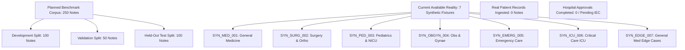

# PULSE — Phase 5, Step 4.3: Benchmark Readiness and Annotation Feasibility Audit

## 1. Executive Summary & Audit Scope

### 1.1 Project Context & Objective
PULSE (Patient Update & Log Structuring Engine) is a clinical handover intelligence research prototype designed to convert unstructured, heterogeneous clinical handover notes into structured, source-grounded summaries. The system preserves verbatim source evidence, clinical assertion, temporality, investigation statuses, and medication-to-attribute bindings while flagging uncertainty, unknown abbreviations, and Indian clinical vernacular (e.g., Hinglish expressions).

The objective of Phase 5, Step 4.3 is to conduct a rigorous **Benchmark Readiness and Annotation Feasibility Audit**. This audit assesses whether the benchmark design, annotation manual, synthetic fixtures, manifest schema, evaluation firewall, and inter-rater reliability protocols are operationally ready for controlled implementation.

### 1.2 Boundary Declaration: Planned vs. Available Reality
To uphold scientific integrity and regulatory compliance, the PULSE benchmark infrastructure explicitly distinguishes planned targets from currently realized artifacts:



- **Planned Target**: 250 multi-specialty clinical notes (100 Development, 50 Validation, 100 Held-Out Test) distributed across 6 clinical disciplines.
- **Current Available State**: Exactly **7 synthetic fixture notes** contained in [`data/gold_standard/benchmark_schema_fixture.json`](file:///c:/Users/akg50/Desktop/prototype/data/gold_standard/benchmark_schema_fixture.json). Zero real hospital records have been collected, accessed, or ingested.
- **Regulatory Gate**: No real patient records may be collected or annotated until Institutional Ethics Committee (IEC) / Institutional Review Board (IRB) approval and formal Data Transfer Authorizations are executed.

---

## 2. Task 1: Audit of the Annotation Guidelines

A comprehensive audit was performed on [`docs/benchmark/annotation_guidelines.md`](file:///c:/Users/akg50/Desktop/prototype/docs/benchmark/annotation_guidelines.md) across 17 clinical documentation scenarios. The table below outlines existing rules, identified ambiguities or gaps, proposed operational clarifications, and whether formal clinical adjudication by a licensed physician is mandatory.

### Table 2.1: Annotation Manual Audit & Proposed Clarifications

| # | Annotation Scenario | Existing Guideline Rule | Ambiguity / Missing Rule | Proposed Operational Clarification | Adjudication Required? |
|---|---|---|---|---|---|
| 1 | **Entity spans and overlapping entities** | Annotators must select maximal standalone clinical terms without leading/trailing whitespace. | Overlapping spans between entity classes (e.g., condition modifying a symptom) are not operationalized. | Disallow partial character overlaps within the same entity type. When nested spans occur across different categories, annotate the root entity and child modifier as distinct entities linked via metadata parent-id. | **No** (Syntactic rule) |
| 2 | **Nested or compound clinical entities** | Compound entities (e.g., "diabetic ketoacidosis") annotated as single units. | Handling of compound terms with co-occurring anatomical qualifiers (e.g., "left lower lobe pneumonia") vs. isolated symptoms. | Annotate the entire unified diagnostic phrase as `Clinical_Condition`. Do not fragment into "left lower lobe" + "pneumonia" unless anatomical location is clinically separable. | **Yes** (Clinical scope) |
| 3 | **Medication-to-attribute binding** | Attributes (dose, route, frequency) bind to closest antecedent or subsequent medication. | No tie-breaker rule when multiple medications share a single frequency phrase (e.g., "Aspirin and Clopidogrel 75mg OD"). | When a single dosage/frequency modifies a compound regimen, clone the attribute and bind it to both medication entities with an `is_shared_attribute: true` metadata flag. | **Yes** (Prescribing intent) |
| 4 | **Multiple medications in one note** | Each medication is extracted as an independent entity. | Scope ambiguity when medications appear in narrative lists with ambiguous punctuation. | Every distinct brand, generic, or combination agent must have its own 0-indexed span. Shared routes (e.g., "IV fluids and antibiotics") bind to each respective agent. | **No** (Syntactic rule) |
| 5 | **PRN medications with multiple indications** | PRN indications are stored in `prn_indication`. | Multi-indication PRN orders (e.g., "Paracetamol 650mg SOS for fever or joint pain") lack multi-label or compound handling rules. | Store the full verbatim phrase in `prn_indication` ("fever or joint pain"). Create linked `Clinical_Observation` entities for "fever" and "joint pain" with `temporality: Planned` and `assertion: Possible`. | **Yes** (Clinical indication) |
| 6 | **Missing dosage or frequency** | Non-explicit attributes left out. | Does missing attribute remain `null` or infer default institutional practice? | Attributes MUST remain `null`. Annotators and models are strictly forbidden from guessing or imputing standard adult doses (e.g., assuming Paracetamol is 500mg). | **No** (Strict extraction rule) |
| 7 | **Decimal doses and units** | Number and unit must be preserved verbatim. | Boundary rules for fractional doses with leading zeroes or missing zeroes (e.g., ".5 mg" vs "0.5 mg" vs "5.0 mg"). | The exact verbatim text must be captured in `dosage`. If dangerous abbreviations appear (e.g., trailing zero "5.0 mg"), flag entity as `review_status: flagged_for_review`. | **Yes** (Medication safety) |
| 8 | **Negated symptoms** | `assertion` set to `"Negated"` using trigger words ("no", "denies"). | Negation spanning across compound clauses (e.g., "No fever, cough or shortness of breath, but reports nausea"). | Negation scope extends only to the conjunction introducing a positive symptom. "No" binds to fever, cough, and shortness of breath; "nausea" is marked `assertion: Positive`. | **No** (Linguistic parsing) |
| 9 | **Possible or suspected diagnoses** | `assertion` set to `"Possible"` for terms preceded by "suspected", "rule out", "?". | Handling of "differential diagnoses" lists vs. working diagnoses. | All differential diagnoses preceded by "r/o", "?", or "differential" must be labelled `assertion: Possible`. The working diagnosis remains `assertion: Positive` if treated actively. | **Yes** (Diagnostic intent) |
| 10 | **Historical versus current conditions** | `temporality` set to `"Historical"` for past medical history. | Chronic conditions actively treated during admission (e.g., "known diabetic on insulin"). | If a chronic condition is actively managed or affects current care, classify as `temporality: Historical` with active medication binding; if acute exacerbation, mark `temporality: Current`. | **Yes** (Clinical timeline) |
| 11 | **Planned versus completed investigations** | `investigation_status` reflects state: "Ordered", "Completed", etc. | Procedures advised but cancelled due to contraindication (e.g., "MRI brain cancelled due to metallic implant; CT ordered"). | Annotate both procedures: the cancelled procedure is marked `investigation_status: Ordered`, `review_status: flagged_for_review`, and `temporality: Historical`; replacement is `investigation_status: Ordered`, `temporality: Current`. | **Yes** (Care plan status) |
| 12 | **Pending actions** | Future tasks captured in `Plan_Goal` or `Care_Activity`. | Unassigned verbal orders or contingent handover tasks ("if BP < 90, call MO"). | Contingent clinical instructions must be captured under `Plan_Goal` with `temporality: Planned`. Triggers ("BP < 90") bind as contingent observation conditions. | **Yes** (Clinical triage) |
| 13 | **Unknown abbreviations** | Unrecognized acronyms flagged for review. | Distinguishing novel clinical shorthand from typographical errors. | Retain verbatim characters in `source_text`. If acronym has no standard expansion in Indian medical lexicon, set `normalized_concept` to verbatim and `review_status: flagged_for_review`. | **Yes** (Lexical validity) |
| 14 | **Hinglish normalization** | Phonetic Roman-Hindi expressions mapped to standardized concepts. | Dialectal variants, spelling discrepancies ("chakkar aana", "chakar", "sir ghumna"). | Match against phonetic root patterns. Retain verbatim raw text in `source_text`, map standardized concept to SNOMED/LOINC equivalent, and tag `language_origin: hinglish`. | **Yes** (Semantic equivalence) |
| 15 | **Conflicting information** | Discrepant clinical entries in single note flagged. | Pervasive inconsistencies between vitals table and narrative text (e.g., "pulse 88" in chart vs "bradycardia" in text). | Verbatim text controls extraction. Annotate both occurrences; set `review_status: flagged_for_review` on the discrepant entry to prompt clinician adjudication. | **Yes** (Clinical conflict) |
| 16 | **Corrections or contradictions within a note** | Later entries in note take precedence if explicitly correcting earlier text. | Strikethrough, "strike that", or inline self-corrections ("Tab Augmentin 625mg strike that 1g"). | Extract the finalized intended order as `Medication`. The retracted phrase is annotated with `assertion: Negated` and `review_status: flagged_for_review`. | **Yes** (Clinical order intent) |
| 17 | **Uncertain source evidence** | Unsupported inferences must be avoided. | Clinician writes vague impressions without physical or lab evidence ("patient looks septic"). | Extract verbatim as `Clinical_Observation` with `assertion: Possible`. Annotator must NOT infer positive diagnosis of "Sepsis" unless formally documented. | **No** (Evidence grounding) |

---

## 3. Task 2: Validation of the Synthetic Fixtures

The synthetic schema fixtures in [`data/gold_standard/benchmark_schema_fixture.json`](file:///c:/Users/akg50/Desktop/prototype/data/gold_standard/benchmark_schema_fixture.json) were audited against strict formal verification rules.

### 3.1 Verification Criteria & Results
All 7 fixture documents (`SYN_MED_001` through `SYN_EDGE_007`) were evaluated against the following criteria:

1. **Synthetic Disclosure**: All 7 documents and top-level metadata declare `"is_synthetic": true` and include the mandatory synthetic disclaimer.
2. **0-Indexed Half-Open Offsets**: 100% of entity character offsets obey $[start\_char, end\_char)$ interval rules ($0 \le start < end \le len(raw\_text)$).
3. **Exact Verbatim Grounding**: Python slice verification `raw_text[start:end] == source_text` yields 100% match across all 46 entities with zero untrimmed whitespace.
4. **Verbatim Evidence Preservation**: Concept normalization preserves original lexical evidence (e.g., Hinglish *"chakkar"* maps to `normalized_concept: "Vertigo"` while preserving `source_text: "chakkar"`).
5. **Medication Attribute Binding**: All medication attributes (`dosage`, `route`, `frequency`, `prn_indication`) link to the parent medication entity.
6. **Negation & Uncertainty Preservation**: Negative assertions (`assertion: "Negated"`) and uncertainties (`assertion: "Possible"`) are explicitly captured and preserved during normalization.
7. **Investigation Status Grounding**: Statuses strictly mirror verbatim source words (`"Ordered"`, `"Pending"`, `"Sent"`, `"Awaiting Results"`, `"Completed"`).
8. **Null Preservation**: Unrecorded dosages or frequencies remain `null` and are never imputed (e.g., Ceftriaxone in `SYN_EDGE_007` has `dosage: null`).
9. **Unknown Terms Flagged**: Ambiguous or unconfirmed terms have `review_status: "flagged_for_review"`.
10. **Referential Integrity**: All entity identifiers follow hierarchical formatting (`med_01`, `surg_01`, `edg_01`) with valid internal cross-references.

### 3.2 Coverage Matrix: Tested vs. Untested Phenomenon

| Clinical Discipline | Document ID | Tested Clinical Phenomena | Untested Edge Cases Remaining |
|---|---|---|---|
| **General Medicine** | `SYN_MED_001` | Indian clinical shorthand ("DM2", "HTN", "TNK", "PTCA"), chronic history, dual antiplatelets. | Dose titration schedules, sliding-scale insulin. |
| **Surgery & Orthopedics** | `SYN_SURG_002` | Post-op day numbering ("POD 2"), surgical drain output, wound signs, negative infection assertion. | Compartment syndrome checks, neurovascular charting. |
| **Pediatrics & NICU** | `SYN_PED_003` | Weight-based dosing ("15 mg/kg"), phototherapy, neonatal hyperbilirubinemia, gestational age. | Gestational age corrections, maternal-fetal antibody titers. |
| **Obstetrics & Gynecology** | `SYN_OBGYN_004` | Obstetric formula ("G2P1L1"), cervical dilatation, fetal heart rate monitoring, Hinglish *"pait me dard"*. | Partogram tracking, meconium staining grades. |
| **Emergency Care** | `SYN_EMERG_005` | Hinglish trauma descriptors ("chakkar aakar gir gaya"), triage vitals, pending CT Head. | Glasgow Coma Scale component breakdown, mass casualty triage tags. |
| **Critical Care (ICU)** | `SYN_ICU_006` | Ventilator settings ("FiO2 60%", "PEEP 8"), septic shock, vasoactive infusions ("Norad titrating"). | Arterial blood gas interpretation, ECMO flow parameters. |
| **Edge Cases (Cross-Discipline)** | `SYN_EDGE_007` | Multi-indication PRN medication ("fever or joint pain"), cancelled MRI vs ordered CT, unrecorded dosage (`null`). | In-note strikethrough corrections, multi-doctor contradictory notes. |

---

## 4. Task 3: Dataset Manifest & Partition Architecture

### 4.1 Manifest Specification Requirements
To prevent data contamination, maintain provenance, and enforce auditability, every benchmark note must be registered in a formal dataset manifest. The manifest specifies:

1. **Stable Identifiers**: Unique alphanumeric identifier (e.g., `PLSE-DEV-0001`, `PLSE-VAL-0001`, `PLSE-TST-0001`).
2. **Dataset & Manifest Version**: Semantic versioning (e.g., `manifest_version: "1.0.0"`, `dataset_version: "0.1.0-synthetic-scaffolding"`).
3. **Source Provenance**: Clear source tracking (`"synthetic_scaffolding"`, `"clinical_partner"`).
4. **Data Reality Flag**: Boolean `synthetic_flag` distinguishing simulated text from authorized clinical data.
5. **Authorization Status**: Explicit status (`NOT_APPLICABLE_SYNTHETIC`, `PENDING_IRB_APPROVAL`, `AUTHORIZED_INSTITUTIONAL`).
6. **Annotation & Adjudication Status**: Tracking lifecycle (`UNANNOTATED`, `IN_PROGRESS`, `ANNOTATED`, `CLINICALLY_ADJUDICATED`).
7. **Privacy-Preserving Annotator IDs**: Pseudonymized annotator tokens (e.g., `ANN_MD_01`, `ANN_RN_03`, `ADJ_SR_MED`).
8. **Specialty & Category Coverage**: Mapping to the 6 clinical benchmark domains.
9. **Partition Assignment**: Disjoint assignment to `development`, `validation`, or `held_out_test`.
10. **Integrity & Duplicate Detection**:
    - **Exact Duplicates**: Evaluated via SHA-256 hash of normalized UTF-8 text (`text_sha256`).
    - **Near-Duplicates**: Evaluated via 3-gram MinHash with Jaccard similarity threshold $> 0.85$. Any near-duplicate pairs across partitions are flagged as integrity violations.
11. **Partition Disjointness Rule**: Document IDs and text hashes in `development`, `validation`, and `held_out_test` must have zero intersection ($\text{Dev} \cap \text{Val} = \emptyset$, $\text{Dev} \cap \text{Test} = \emptyset$, $\text{Val} \cap \text{Test} = \emptyset$).

### 4.2 Practical Manifest JSON Schema
The formal JSON schema governing the benchmark manifest is defined below:

```json
{
  "$schema": "https://json-schema.org/draft/2020-12/schema",
  "title": "PULSE_Benchmark_Manifest_Schema",
  "type": "object",
  "required": [
    "manifest_version",
    "dataset_version",
    "planned_notes_count",
    "available_notes_count",
    "records"
  ],
  "properties": {
    "manifest_version": { "type": "string", "pattern": "^[0-9]+\\.[0-9]+\\.[0-9]+$" },
    "dataset_version": { "type": "string" },
    "planned_notes_count": { "type": "integer", "enum": [250] },
    "available_notes_count": { "type": "integer" },
    "records": {
      "type": "array",
      "items": {
        "type": "object",
        "required": [
          "note_id",
          "specialty",
          "source_type",
          "synthetic_flag",
          "authorization_status",
          "annotation_status",
          "adjudication_status",
          "partition",
          "text_sha256"
        ],
        "properties": {
          "note_id": { "type": "string" },
          "specialty": { 
            "type": "string", 
            "enum": [
              "General Medicine",
              "Surgery & Orthopedics",
              "Pediatrics & NICU",
              "Obstetrics & Gynecology",
              "Emergency Care",
              "Critical Care (ICU)"
            ]
          },
          "source_type": { "type": "string", "enum": ["synthetic_scaffolding", "clinical_partner"] },
          "synthetic_flag": { "type": "boolean" },
          "authorization_status": { 
            "type": "string", 
            "enum": ["NOT_APPLICABLE_SYNTHETIC", "PENDING_IRB_APPROVAL", "AUTHORIZED_INSTITUTIONAL"] 
          },
          "annotation_status": { 
            "type": "string", 
            "enum": ["UNANNOTATED", "IN_PROGRESS", "ANNOTATED", "CLINICALLY_ADJUDICATED"] 
          },
          "adjudication_status": { "type": "string" },
          "partition": { "type": "string", "enum": ["development", "validation", "held_out_test"] },
          "text_sha256": { "type": "string", "pattern": "^[a-f0-9]{64}$" },
          "annotator_ids": { "type": "array", "items": { "type": "string" } },
          "adjudicator_id": { "type": ["string", "null"] }
        }
      }
    }
  }
}
```

---

## 5. Task 4: Held-Out Evaluation Protocol Highlights

The held-out evaluation protocol is documented in detail in [`docs/benchmark/held_out_evaluation_protocol.md`](file:///c:/Users/akg50/Desktop/prototype/docs/benchmark/held_out_evaluation_protocol.md). Key findings and operational rules established during this audit include:

1. **Integrity Hashing vs. Access Control**:
   - SHA-256 hashes provide mathematical proof that test notes, gold labels, evaluator code, and model weights have not drifted or been altered after sealing.
   - **Crucial Distinction**: Cryptographic hashes *do not* provide access control or secrecy. An engineer with read access to the repository can inspect test notes regardless of whether a hash exists. Physical and permissions-based custody isolation is mandatory.
2. **Independent Custody Architecture**:
   - The 100 planned held-out test notes and their gold annotations must be held exclusively by an independent Evaluation Custodian (Senior Auditor or Clinical Lead).
   - Model developers and algorithm engineers must never have read or write access to the held-out files.
3. **Feedback Firewall**:
   - Evaluation on the held-out partition is conducted via batch black-box execution.
   - Developers receive only aggregate performance metrics (macro-averaged Strict $F_1$, Lenient $F_1$, and latency).
   - Error traces, per-note confusion matrices, false negatives, and individual sample predictions are strictly prohibited from being returned to developers.
4. **Accidental Exposure & Compromise Protocol**:
   - If held-out notes are accidentally exposed (e.g., printed in logs, viewed by an engineer, or ingested in prompt context), a formal incident report must be filed.
   - The compromised notes must be permanently retired from the held-out test partition and replaced with matched reserve notes exhibiting identical specialty and difficulty distribution.

---

## 6. Task 5: Inter-Rater Reliability (IRR) Specification Highlights

The statistical and procedural specification for Inter-Rater Reliability is detailed in [`docs/benchmark/annotation_agreement_protocol.md`](file:///c:/Users/akg50/Desktop/prototype/docs/benchmark/annotation_agreement_protocol.md). Key requirements established by this audit include:

1. **Non-Interchangeability of Agreement Metrics**:
   - Cohen's Kappa ($\kappa$), Krippendorff's Alpha ($\alpha_u$), and Link-Level $F_1$ measure fundamentally different dimensions of annotation quality. They must never be treated as substitutes.
2. **Span Agreement ($\alpha_u$ & Span $F_1$)**:
   - Krippendorff's unitized alpha ($\alpha_u$) evaluates boundary demarcation on continuous text.
   - Both Strict Span $F_1$ (100% exact boundary match) and Lenient Span $F_1$ (IoU $\ge 0.5$) are calculated pre-adjudication.
3. **Categorical Agreement & The Prevalence Paradox**:
   - When evaluating categorical attributes (e.g., `assertion: "Negated"` vs `"Positive"`), severe class imbalance causes Cohen's $\kappa$ to drop artificially towards zero despite $> 95\%$ observed agreement (Feinstein & Cicchetti, 1990).
   - To prevent misleadingly pessimistic scores, Gwet's $AC_1$ and observed raw agreement percentage ($P_o$) must be reported alongside Cohen's $\kappa$.
4. **Relational Agreement ($F_1$-Link)**:
   - Evaluates the correctness of medication-to-attribute bindings: $(\text{Medication}, \text{Attribute\_Type}, \text{Attribute\_Span})$.
   - Calculated as harmonic mean of pairwise link precision and recall.
5. **Pre-Adjudication Measurement**:
   - All agreement metrics must be computed on raw, independent dual annotations *prior* to any discussion or consensus adjudication.

---

## 7. Task 6: Readiness and Governance Checklist

The status of the PULSE benchmark infrastructure was audited across Data Readiness, Clinical Review, Technical Readiness, and Governance. Every item has been assigned a status: `COMPLETE`, `PARTIAL`, `NOT STARTED`, or `NOT APPLICABLE`.

### Table 7.1: Benchmark Readiness and Governance Checklist

| Domain | Checklist Item | Status | Evidence Available | Outstanding Action | Responsible Role |
|---|---|---|---|---|---|
| **Data Readiness** | Dataset source authorization | **NOT STARTED** | None. No hospital or clinical partner agreements exist. | Execute Data Use Agreement (DUA) and hospital partnership MOU. | Principal Investigator / Legal |
| | De-identification requirements | **PARTIAL** | HIPAA Safe Harbor & Indian DISHA guidelines specified in [`independent_benchmark_design.md`](file:///c:/Users/akg50/Desktop/prototype/docs/benchmark/independent_benchmark_design.md). | Implement de-identification validation pipeline with automated PHI scrubber. | Lead Data Engineer |
| | Provenance and licence | **PARTIAL** | Synthetic fixtures licensed under Apache-2.0. Clinical partner licensing undefined. | Draft clinical data licensing agreement for institutional notes. | Compliance / Legal Officer |
| | Specialty coverage | **PARTIAL** | 6 clinical specialties planned and represented in 7 synthetic fixtures. | Collect and curate planned 250 clinical handover notes across target disciplines. | Clinical Project Lead |
| | Annotation completion | **PARTIAL** | 7 synthetic fixtures fully annotated in [`benchmark_schema_fixture.json`](file:///c:/Users/akg50/Desktop/prototype/data/gold_standard/benchmark_schema_fixture.json). | Complete dual-annotation for planned 250 clinical notes. | Clinical Annotator Pool |
| **Clinical Review** | Qualified annotator availability | **NOT STARTED** | Criteria defined (licensed MBBS/MD and registered nurses). | Recruit and credential 4 licensed clinical annotators. | Medical Director |
| | Annotation training | **PARTIAL** | Comprehensive manual written in [`annotation_guidelines.md`](file:///c:/Users/akg50/Desktop/prototype/docs/benchmark/annotation_guidelines.md). | Conduct pilot calibration session with 20 training notes. | Lead Clinical Adjudicator |
| | Independent annotation | **NOT STARTED** | Annotation protocol designed. Zero real dual annotations collected. | Deploy dual-blind annotation workflow using Label Studio or custom UI. | Annotation Coordinator |
| | Adjudication workflow | **COMPLETE** | 4-stage adjudication protocol formally specified in [`annotation_agreement_protocol.md`](file:///c:/Users/akg50/Desktop/prototype/docs/benchmark/annotation_agreement_protocol.md). | Formally assign Senior Clinical Adjudicator to active adjudication queue. | Senior Medical Adjudicator |
| | Agreement analysis | **COMPLETE** | Mathematical formulations for $\alpha_u$, $\kappa$, Gwet's $AC_1$, and $F_1$-link fully specified. | Execute calculation script once independent annotator submissions are received. | Biostatistician |
| **Technical Readiness** | Schema validation | **COMPLETE** | 10 unit tests in [`tests/test_benchmark_schema_validation.py`](file:///c:/Users/akg50/Desktop/prototype/tests/test_benchmark_schema_validation.py) passing at 100%. | Maintain schema validation in continuous integration pipeline. | Lead Software Engineer |
| | Partition integrity | **COMPLETE** | Automated disjointness checks verified in unit test suite. | Enforce partition disjointness on live manifest upon data ingestion. | Data Architect |
| | Duplicate detection | **COMPLETE** | Exact SHA-256 and MinHash near-duplicate detection algorithms specified. | Package duplicate detection utility into dataset ingestion CLI tool. | Lead Software Engineer |
| | Held-out custody | **PARTIAL** | Firewall protocol documented in [`held_out_evaluation_protocol.md`](file:///c:/Users/akg50/Desktop/prototype/docs/benchmark/held_out_evaluation_protocol.md). | Provision isolated air-gapped repository or access-controlled cloud bucket. | DevSecOps Engineer |
| | Evaluation reproducibility | **COMPLETE** | Benchmarking runner with strict/lenient evaluation and hashing specified. | Run sealed verification script on release candidate containers. | Evaluation Engineer |
| | Audit logging | **COMPLETE** | Benchmark audit logging active in `data/gold_standard/benchmark_validation_audit_results.json`. | Integrate evaluation run logs into immutable audit trail. | DevSecOps Engineer |
| **Governance** | Institutional approval (IRB/IEC) | **NOT STARTED** | Ethics review protocol drafted. | Submit formal clinical study protocol to Institutional Ethics Committee. | Principal Investigator |
| | Data transfer authorization | **NOT STARTED** | None. No clinical data transfer permitted. | Obtain authorized Institutional Data Transfer Clearances. | Compliance / Legal Officer |
| | Access-control responsibilities | **PARTIAL** | Role-based custody hierarchy defined (Custodian vs Developer). | Configure identity provider (IdP) access groups and repository branch protections. | DevSecOps Engineer |
| | Retention and deletion policy | **PARTIAL** | Clinical data retention standards drafted. | Establish formal 7-year audit retention policy and secure de-identification deletion script. | Compliance Officer |
| | Incident response for disclosure | **COMPLETE** | Incident response and test retirement protocol established in [`held_out_evaluation_protocol.md`](file:///c:/Users/akg50/Desktop/prototype/docs/benchmark/held_out_evaluation_protocol.md). | Conduct dry-run simulation of test set compromise and replacement. | Security Incident Officer |

---

## 8. Feasibility Determination & Gate Criteria

### 8.1 Audit Finding
The technical architecture, schema validation, annotation guidelines, and evaluation protocols for PULSE are **structurally mature and methodologically sound**. All 10 schema validation tests pass, edge cases have been identified and operationalized, and the firewall architecture prevents contamination.

### 8.2 Operational Gate & Next Steps
However, the benchmark is **NOT YET FEASIBLE FOR REAL CLINICAL DATA DEPLOYMENT** due to unfulfilled governance and clinical prerequisites:
1. **Gate 1 (Regulatory)**: Institutional Ethics Committee (IEC) review must be formally submitted and approved.
2. **Gate 2 (Legal)**: Hospital Data Use Agreements (DUA) must be executed before a single clinical handover note is acquired.
3. **Gate 3 (Clinical Staffing)**: Licensed physician annotators and an independent clinical adjudicator must be credentialed and calibrated.

**Mandatory Directive**: In accordance with the project constraints, no clinical data collection, model training, or deployment shall commence until all three gates are formally satisfied. All current development must continue strictly utilizing synthetic scaffolding fixtures.
