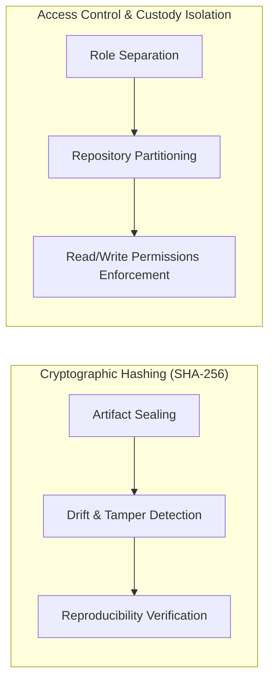
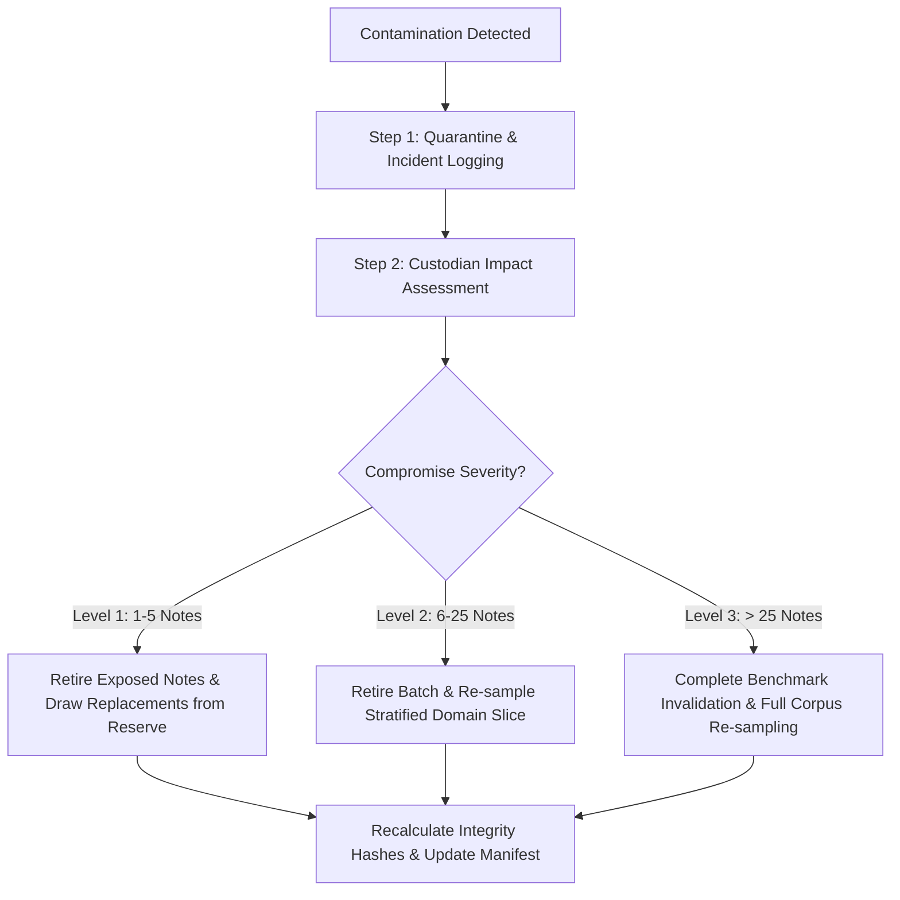

# PULSE — Held-Out Evaluation Protocol & Firewall Architecture

## 1. Scope & Objective

This document defines the operational architecture, custody constraints, and evaluation workflows for the **Held-Out Test Partition** (100 notes planned) in the PULSE benchmark.

The primary objective is to maintain an absolute firewall between model development and final independent evaluation. This guarantees that evaluation scores reflect true generalization capability rather than subtle overfitting, data leakage, or post-hoc heuristic tuning.

---

## 2. Integrity Hashing vs. Access Control: Fundamental Distinction

A foundational security principle of the PULSE evaluation protocol is recognizing the exact boundary between data integrity and data confidentiality:



### 2.1 What SHA-256 Hashes Provide (Data Integrity Evidence)
- **Deterministic Verification**: Computing SHA-256 digests over test text files, gold annotation JSONs, model checkpoints, lexicon files, and evaluator source scripts provides unforgeable mathematical proof that artifacts have not drifted, decayed, or been edited after benchmark sealing.
- **Auditability**: Hashes enable independent auditors to verify that the evaluation was executed on the exact frozen snapshot declared in the benchmark manifest.

### 2.2 What SHA-256 Hashes Do NOT Provide (Access Control & Secrecy)
- **No Confidentiality**: Hashing a file does not encrypt it, hide it, or restrict read permissions. An engineer with file-system read access to a hashed file can read its raw clinical text and gold entities in plain text.
- **No Independence Guarantee**: A hash alone cannot prevent a developer from writing regexes or heuristics tailored to specific held-out test notes if the developer has access to the test repository.
- **Current Repository State**: The local repository currently operates under standard file-system permissions. **No automated key management, hardware security module (HSM), or encrypted enclaves have been deployed.** Access control is therefore enforced administratively and procedurally until isolated cloud custody is commissioned.

---

## 3. Custody Architecture & Separation of Duties

To enforce benchmark independence without introducing fictitious security infrastructure, the protocol establishes strict **Role-Based Custody Separation**:

### Table 3.1: Custody Matrix Across Benchmark Splits

| Benchmark Split | Planned Note Count | Realized Fixture Count | Primary Custodian | Developer Access Level | Permitted Usage |
|---|---|---|---|---|---|
| **Development Split** | 100 notes | 4 synthetic notes (`SYN_MED_001`, `SYN_SURG_002`, `SYN_OBGYN_004`, `SYN_EDGE_007`) | Algorithm Engineers | **Full Read / Write** | Rule discovery, lexicon expansion, error analysis, unit testing. |
| **Validation Split** | 50 notes | 2 synthetic notes (`SYN_PED_003`, `SYN_EMERG_005`) | Evaluation Lead | **Read-Only (Evaluation Harness)** | Model checkpoint selection, hyperparameter tuning, regression verification. |
| **Held-Out Test Split** | 100 notes | 1 synthetic note (`SYN_ICU_006`) | Independent Evaluation Custodian | **STRICT ZERO ACCESS** | Final sealed evaluation. Never exposed during development. |

### 3.1 Role Responsibilities
1. **Independent Evaluation Custodian (Clinical Lead or External Auditor)**:
   - Sole administrator holding custody of held-out notes and gold annotations.
   - Executes the automated evaluation container or runner.
   - Seals and publishes official evaluation audit logs.
   - Is strictly prohibited from developing clinical extraction rules, lexicons, or model architectures.
2. **Model Developers / Algorithm Engineers**:
   - Write and maintain clinical extraction models, shorthand normalizers, and pipeline orchestrators.
   - Have full access to the Development partition and bounded evaluation access to the Validation partition.
   - Are strictly forbidden from accessing, inspecting, viewing, or querying held-out test notes.

---

## 4. Evaluation Execution Protocol (Black-Box Testing)

```mermaid
sequenceDiagram
    autonumber
    actor Dev as Model Developers
    participant Repo as Sealed Pipeline & Weights
    actor Cust as Evaluation Custodian
    participant Box as Isolated Evaluation Runner
    participant Log as Immutable Audit Log
    
    Dev->>Repo: Freeze Model Weights & Code (Release Tag)
    Cust->>Cust: Verify SHA-256 Hashes (Code, Weights, Config)
    Cust->>Box: Mount Held-Out Test Set (Air-Gapped)
    Cust->>Box: Execute Black-Box Evaluation Harness
    Box->>Log: Record Raw Predictions & Exact Hashes
    Box->>Cust: Output Summary Report (Strict F1, Lenient F1)
    Cust->>Dev: Return Aggregate Performance Only
    Note over Dev: No individual error cases, false negatives, or raw predictions returned
```

### 4.1 Sealing the Evaluation Snapshot
Before executing evaluation on the held-out test set, the Evaluation Custodian computes and records the SHA-256 digests of:
1. `evaluator_code_sha256`: Hash of `backend/evaluation/benchmark_runner.py` and evaluation harness.
2. `model_weights_sha256`: Hash of model checkpoint binaries (`pytorch_model.bin` or safetensors).
3. `lexicon_assets_sha256`: Hash of clinical shorthand and Hinglish normalizer dictionaries.
4. `evaluation_config_sha256`: Hash of evaluation parameters (IoU thresholds, metric definitions).
5. `held_out_test_sha256`: Hash of the held-out test corpus text and annotations.

### 4.2 Recording the Evaluation Run
Every evaluation run generates a sealed execution audit record stored in `data/gold_standard/evaluation_audit_runs/`:

```json
{
  "evaluation_id": "EVAL_RUN_2026_HELD_OUT_001",
  "timestamp": "2026-10-25T15:00:00Z",
  "evaluator_custodian_id": "AUDITOR_EXT_01",
  "system_evaluated": "PULSE Hybrid Pipeline v0.2.0",
  "hashes": {
    "code_commit_sha": "f332d1950a40491cb8308d6722e075f7",
    "evaluator_script_sha256": "e3b0c44298fc1c149afbf4c8996fb92427ae41e4649b934ca495991b7852b855",
    "held_out_corpus_sha256": "8a3c4f2e9d1b7a6c5e8f0a1d3b5c7e9f2a4b6c8d0e1f3a5b7c9d1e3f5a7b9c1d",
    "predictions_output_sha256": "4b2c1d9e8f0a3b5c7e9f1a2b4c6d8e0f1a3b5c7e9f2a4b6c8d0e1f3a5b7c9d1e"
  },
  "aggregate_metrics": {
    "strict_f1": 0.785,
    "lenient_f1": 0.892,
    "mean_latency_ms": 28.4
  }
}
```

---

## 5. Feedback Firewall: Preventing Test-Set Feedback Loops

A pervasive failure mode in clinical NLP benchmarking is "leakage via feedback", where developers inspect test-set failure cases and iteratively patch regular expressions or vocabularies to overfit the test set.

### 5.1 Feedback Restrictions
1. **Aggregate Scores Only**: Developers are provided exclusively with macro-averaged metrics:
   - Overall Strict $F_1$, Lenient $F_1$, Precision, Recall.
   - Specialty-level aggregate $F_1$ (e.g., General Medicine vs. Surgery).
   - Mean inference latency per note.
2. **Strict Prohibition on Granular Feedback**:
   - Individual error samples, false negative lists, and per-token mismatches from the held-out test set are **strictly prohibited** from being shared with developers.
   - Raw model prediction outputs on held-out notes are retained exclusively in the Custodian's audit vault.
3. **No Direct Rule Patches**: Developers are forbidden from creating shorthand dictionary entries or regex patterns based on knowledge of held-out clinical text.

---

## 6. Incident Response & Test-Set Retirement Policy

Despite custody controls, accidental exposure can occur (e.g., a test note printed in a debugging stack trace, committed to a public development branch, or pasted into an AI assistant context).

### 6.1 Contamination Severity Levels
- **Level 1 (Minor Leakage)**: 1 to 5 notes viewed by an engineer or printed in a private debug log without being stored in public training data.
- **Level 2 (Moderate Leakage)**: 6 to 25 notes checked into a shared development branch or accessible to multiple developers.
- **Level 3 (Catastrophic Compromise)**: $> 25$ notes or the entire held-out test gold file exposed publicly, ingested into a base model's training corpus, or committed to open source.

### 6.2 Incident Response Workflow


### 6.3 Replacement & Re-sampling Protocol
1. **Deprecation**: Compromised notes are marked `"partition": "deprecated_compromised"` in the manifest and moved to an archived quarantine folder.
2. **Reserve Pool Activation**: The benchmark design maintains a 20% reserve pool (20 additional notes per 100 planned).
3. **Stratified Replacement**: Replacement notes must match the exact specialty domain, clinical difficulty, and shorthand density of the retired notes.
4. **Manifest Re-sealing**: The dataset version is incremented (e.g., `v1.0.0` $\to$ `v1.0.1`), a new SHA-256 hash is computed, and the incident rationale is permanently recorded in the benchmark changelog.

---

## 7. Secrets, Credentials, and Clean Repository Rules

In strict adherence to security best practices:
1. **Zero Credentials in Code**: No passwords, API keys, private decryption keys, or tokens shall ever be hardcoded or checked into repository files.
2. **No Fictitious Claims**: This protocol does not claim that end-to-end homomorphic encryption or physical air-gaps are currently running. It defines the formal operational rules, administrative custody, and verification procedures that govern the PULSE benchmark.
